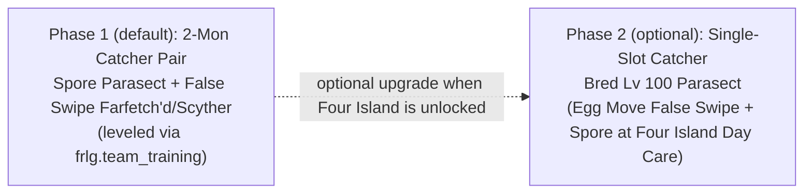
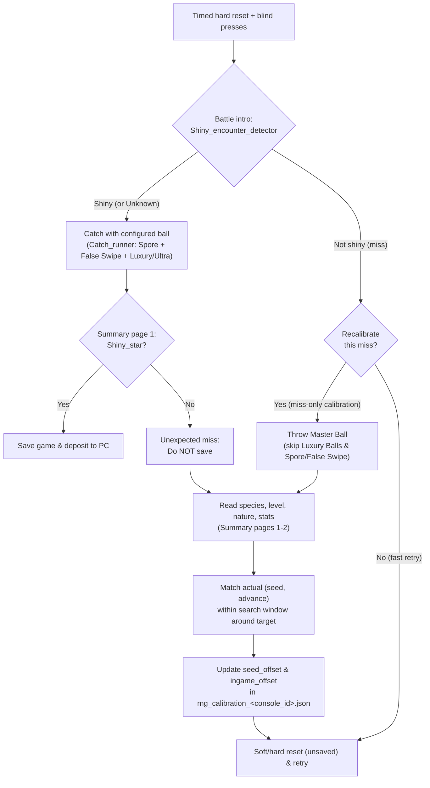

# FRLG Dex Collection (`frlg.dex_collection`), Engineering Design

Design for expanding `frlg.dex_collection` from its initial three mGBA grass checkpoints into a
complete, Switch-ready collector for the **13 Kanto FireRed version-exclusive shinies** (per
evolution line), scaling cleanly across encounter methods, catcher progressions, visual battle-intro
shiny detection, and console calibration.

Related docs:
- Roadmap: [docs/roadmap/frlg-dex-exclusives.md](../roadmap/frlg-dex-exclusives.md) (A6),
  [docs/roadmap/frlg-rng-port.md](../roadmap/frlg-rng-port.md) (A5)
- Guides: [docs/guide/frlg.dex_collection.md](../guide/frlg.dex_collection.md),
  [docs/guide/frlg.wild_rng.md](../guide/frlg.wild_rng.md)
- ACE item prep: [docs/design/FRLG-ACE-Execution.md](FRLG-ACE-Execution.md)
- Shared catch engine: `src/pokemon/catch/` (`gamepilot.pokemon_catch`, introduced in PR #337)
- Visual battle-intro shiny detection reference: BDSP `Bdsp_readers.Shiny_encounter_detector` /
  `Shiny_encounter_reader` (`src/games/pokemon/bdsp/readers/lib/shiny_encounter_{detector,reader}.{ml,mli}`,
  PR #334)

---

## Decisions (agreed 2026-11-26)

All six architectural decisions for `frlg.dex_collection` are settled:

1. **Two-phase catcher progression**: Focus purely on the 13 Kanto FireRed-exclusive shinies.
   Phase 1 starts right away with a 2-Pokémon catcher pair (**Spore Parasect + False Swipe
   Farfetch'd/Scyther**, leveled via `frlg.team_training`). Phase 2 (a single bred **Lv 100
   Parasect** with Egg Move **False Swipe + Spore** at Four Island Day Care) is an optional
   single-slot upgrade whenever Four Island Day Care is unlocked.
2. **Shared catch engine (`src/pokemon/catch/`) + visual battle-intro shiny detection**: Reuse
   `Catch_state`, `Catch_policy`, and `Catch_runner` for both the 2-mon pair (`status_setter` +
   `false_swiper` on distinct slots) and the 1-mon Parasect (`status_setter.slot =
   false_swiper.slot = 1`), backed by three new FRLG battle HUD probes (foe HP ratio, player HP
   ratio, foe SLP/PAR status badge). Add a visual battle-intro shiny detector for FRLG (modeled on
   BDSP's `Bdsp_readers.Shiny_encounter_detector` from PR #334) so `wild_rng` distinguishes shiny
   from non-shiny **before** committing to Spore/False Swipe and Luxury/Ultra Balls, while still
   confirming `Frlg_readers.Shiny_star` on Summary before saving.
3. **Switch Wild RNG calibration**: Calibrate **once per console**, persisted by console ID in the
   local GamePilot data directory (`~/.local/share/gamepilot/frlg/`). On a battle-intro miss, skip
   Luxury Balls and Spore/False Swipe — either soft-reset immediately or throw a Master Ball for
   miss-only auto-recalibration (read Summary stats/nature → refine seed/advance offsets → soft
   reset without saving).
4. **Composable parameterized plans (`Engine_expand`)**: Replace repetitive ~100-line per-species
   checkpoint JSON files with four parameterized fragment templates (`wild_rng_grass_catch`,
   `wild_rng_surf_catch`, `wild_rng_fish_catch`, `gift_rng_prize`) so each species checkpoint is
   ~10 lines.
5. **Evolution-line counts & ball sourcing**: Upgrade `dex_progress.json` from a boolean caught
   list to per-species counts covering all 13 FireRed Kanto exclusives (Ekans ×2, Growlithe ×2,
   Oddish ×3, Psyduck ×2, Shellder ×2, Electabuzz ×1, Scyther ×1), and support
   `--options ball=ultra-ball|luxury-ball` (Ultra Balls pre-ACE, Luxury Balls post-ACE).
6. **Ordered vertical-slice milestones**: Land the work in six incremental PRs — Phase 1 catcher
   prep → FRLG battle HUD readers, visual battle-intro shiny detector & catch adapter →
   `Engine_expand` catch templates & count-based progress → Switch per-console calibration &
   miss-recalibration → Surf/Super Rod/Power Plant/Gift RNG exclusives → optional Phase 2 Four
   Island Parasect breeding.

---

## 1. Two-Phase Catcher Progression

Today `frlg.dex_collection` throws Ultra Balls at full HP without weakening (`Capture.run`). That
suffices for high-catch-rate Route 10/11 targets, but fails or wastes turns on lower-catch-rate
targets such as Electabuzz (catch rate 45) and Luxury Ball catches (1× multiplier, same as Poké
Ball). At 1 HP and Asleep, Ekans, Oddish, Psyduck, Growlithe, and Shellder are guaranteed catches
in a Luxury Ball, and Electabuzz rises to ~36% per ball.

Breeding a single False Swipe + Spore Parasect requires Four Island Day Care, which is not needed
to collect the 13 FireRed-exclusive shinies. Phase 1 uses a 2-Pokémon catcher pair right away, and
Phase 2 is an optional single-slot upgrade whenever Four Island Day Care is unlocked:



### Phase 1 — 2-Mon Catcher Pair (Immediate)

- **Slot 1 — Sleeper (Parasect)**: Catch Paras in Mt. Moon, evolve at Lv 24, learn **Spore** at
  Lv 27 (100% accuracy Sleep).
- **Slot 2 — False Swiper (Farfetch'd or Scyther)**:
  - **Farfetch'd** (`CH'DING`, Vermilion City in-game trade — already obtained by `frlg.mail_glitch`)
    learns **False Swipe** at Lv 25 and requires zero extra Safari/Game Corner setup.
  - **Scyther** (Celadon Game Corner or Safari Zone) learns **False Swipe** at Lv 16 and serves as
    the male parent for Phase 2 breeding.
- **Leveling**: Both are leveled via `frlg.team_training` (e.g. Lv 70–100) so they outspeed and
  reliably survive Kanto wild encounters (Lv 15–35).
- **Party layout (5 members + 1 free slot for Wild/Gift RNG)**:
  1. Spore Parasect (Slot 1)
  2. False Swipe Farfetch'd / Scyther (Slot 2)
  3. Fly user (Slot 3; Farfetch'd can also double as Fly user)
  4. Surf user (Slot 4)
  5. Sweet Scent user (Slot 5, last occupied slot, as required by `Wild_rng_steps.blind_presses`)
  6. *Empty* (Slot 6 — receives the caught shiny so `Wild_rng_steps.shiny_at ~slot:6` can read its
     summary star before saving and depositing)

### Phase 2 — Optional Single-Slot Catcher (Four Island Day Care)

- **Availability**: Optional upgrade whenever Four Island Day Care is unlocked (not required to
  collect the 13 FireRed exclusives).
- **Breeding**: Pair a male **False Swipe** Farfetch'd or Scyther with a female Paras/Parasect at
  Four Island Day Care to hatch a Paras with Egg Move **False Swipe**, evolve to Parasect, learn
  **Spore** (Lv 27), and level to **Lv 100** via `frlg.team_training` or ACE Rare Candies
  (`frlg.ace`, item `0x0044`).
- **Held item**: Leftovers or Lum Berry.
- **Benefit**: Consolidates Sleeper + False Swiper into **Slot 1**, freeing a party slot for
  additional HM/utility coverage (Cut, Flash, Teleport/Dig) while keeping the exact same catch
  engine and policy code.

---

## 2. Catch Engine Integration & FRLG Battle Reader Audit

### 2.1 Reusing `src/pokemon/catch/` (`gamepilot.pokemon_catch`)

The game-agnostic catch engine (`src/pokemon/catch/lib/`, PR #337) provides:
- `Catch_state`: battle observation (`turn`, `active_slot`, `active_hp_ratio`, `foe_hp_ratio`,
  `foe_status`, `balls_thrown`, `fainted`), role configs (`role_config`, `false_swipe_config`,
  `wall_config`), `policy`, and `command` (`Use_move | Switch_to | Throw_ball | Heal_active |
  Pause_for_user` — intentionally omitting `Run` so automation can never flee from a shiny).
- `Catch_policy`: pure safety-first `decide` (turn/ball limits → survival heal/retreat →
  False Swipe chipping with `foe_hp_target`/`foe_hp_rechip` and `require_status` → status
  re-application → ball throw) and `next_send_in`.
- `Catch_runner`: event loop over `Catch_runner.game_steps` (`next_event`, `execute`, `send_in`),
  pausing safely on limits, unexpected prompts, or exhausted send-ins.

Both catcher phases map directly onto `Catch_state.policy` with **no engine changes**:

| Policy field | Phase 1 (2-mon pair) | Phase 2 (1-mon Parasect) |
|---|---|---|
| `status_setter` | `Some { slot = 1; move_slot = spore; hp_floor = 0.35 }` | `Some { slot = 1; move_slot = spore; hp_floor = 0.35 }` |
| `false_swiper` | `Some { slot = 2; move_slot = false_swipe; require_status = true; hp_floor = 0.35 }` | `Some { slot = 1; move_slot = false_swipe; require_status = true; hp_floor = 0.35 }` |
| `wall` | `Some { slot = 1; heal_move_slot = None; hp_floor = 0.35 }` (or `None`) | `None` |
| `foe_hp_target` | `0.15` | `0.15` |
| `foe_hp_rechip` | `0.25` | `0.25` |
| `reapply_status` | `true` | `true` |
| `ball_name` | `ultra-ball` or `luxury-ball` (from `--options ball=...`) | `ultra-ball` or `luxury-ball` |
| `send_in_order` | `[ 1; 2; 3; 4; 5 ]` | `[ 1; 2; 3; 4 ]` |

In Phase 1, `Catch_policy.decide` opens with Spore on Slot 1, switches to Slot 2 to chip with False
Swipe while the foe sleeps, optionally retreats to Slot 1 (or stays on Slot 2) to throw balls, and
re-applies Spore if the foe wakes up. In Phase 2, `status_setter.slot = false_swiper.slot = 1`
keeps Slot 1 on the field for Spore → False Swipe → ball throws with zero switches.

### 2.2 FRLG Battle Reader & Battle Engine Audit

An audit of `src/games/pokemon/frlg/readers/lib/` and `src/games/pokemon/frlg/battle/lib/` shows
that screen navigation, menus, and forced switches are already implemented; the missing pieces are
the **three HUD value probes**, the **visual battle-intro shiny detector**, and the **FRLG
`Catch_runner.game_steps` adapter**.

#### Already implemented (reuse as-is)

| Capability | Module | Details |
|---|---|---|
| Battle text box & action menu | `Frlg_readers.Battle_screen` (`battle_screen.{ml,mli}`) | `battle_text_box`, `battle_menu` (English & Japanese FIGHT/BAG/POKéMON/RUN), `move_menu`, `level_up_box`, `battle_shows`. |
| HP box presence | `Frlg_readers.Battle_screen` | `player_box`, `player_box_left`, `foe_box`, `ally_boxes` — detect whether the HP box frame is on screen (presence only, not HP fill). |
| Caught Poké Ball mark | `Frlg_readers.Caught_mark` (`caught_mark.{ml,mli}`) | `caught` / `read` at GBA pixels x 20–26, y 31–37 on the foe HP box. Note: `pokefirered` (`src/battle_interface.c`) clears this tile whenever the foe has a major status. |
| Battle YES/NO & move-learn vs faint | `Frlg_readers.Battle_yes_no` (`battle_yes_no.{ml,mli}`) | `yes_no_box` and `move_learn` (`yes_no_box && player_box_left`, separating move-learn prompts from wild `"Use next POKéMON?"` where `player_box` is gone). |
| Text advance arrow & 0 PP | `Frlg_readers.Battle_text_arrow`, `Frlg_readers.Move_pp` | `arrow` (red prompt triangle) and `no_pp_left` (red 0 PP indicator on move menu). |
| Party & Bag screens | `Frlg_readers.Party_menu`, `Frlg_readers.Bag_screen` | `party_menu`, `layout` (`Single \| Double`), `selected_slot`, `slot_empty`, `members`, `mark`; Bag pocket navigation for Poké Balls and healing items. |
| Summary screen & shiny star | `Frlg_readers.Summary_screen`, `Frlg_readers.Shiny_star` | Summary pages 1–3 (`Summary_screen.page`) and shiny star on page 1 (`Shiny_star`). |
| Battle screen classifier & steps | `Frlg_battle.Battle_look`, `Frlg_battle.Battle`, `Frlg_battle.Battle_steps` | `Battle_look.classify` (`Action_menu`, `Move_menu`, `Party_list`, `Bag`, `Yes_no`, `Text_arrow`, `Level_up`, `Evolution`, `Battle_text`, `No_battle`); `Battle_steps.make` implements `Battle.game_steps` (`next_event`, `use_move`, `switch_to`, `send_in`, `use_item`, `answer_use_next`). |

#### Missing (to add in Milestone PR 2)

| Missing item | Target module | Design |
|---|---|---|
| **Foe HP bar ratio** | `Frlg_readers.Battle_hud` (`src/games/pokemon/frlg/readers/lib/battle_hud.{ml,mli}`) | Segmented `color_stats` probes along the 48-pixel GBA foe HP bar inside `foe_box` (green/yellow/red filled segments vs dark empty track), gated by `Battle_screen.foe_box`. Returns `float option` in `[0.0 .. 1.0]`. |
| **Player HP bar ratio** | `Frlg_readers.Battle_hud` | Segmented `color_stats` probes along the 48-pixel GBA player HP bar inside `player_box`, gated by `Battle_screen.player_box`. Returns `float option` in `[0.0 .. 1.0]`. |
| **Foe status badge (SLP/PAR/other)** | `Frlg_readers.Battle_hud` | Color probe on the 20×8 GBA status icon box on the foe HP box (`pokefirered` `graphics/interface/status_icons.pal`: silver/grey `SLP` → `Asleep`, yellow `PAR` → `Paralyzed`, purple `PSN` / orange-red `BRN` / cyan `FRZ` → `Other_status`, cream HP-box background → `Healthy`), gated by `Battle_screen.foe_box`. |
| **Visual battle-intro shiny detector** | `Frlg_readers.Shiny_encounter_reader` & `Frlg_readers.Shiny_encounter_detector` (`src/games/pokemon/frlg/readers/lib/shiny_encounter_{reader,detector}.{ml,mli}`) | Modeled on BDSP's `Bdsp_readers.Shiny_encounter_reader` / `Shiny_encounter_detector` (PR #334). Watches the wild battle opening using `Battle_screen` probes and measures the ~1.1–1.3 s shiny sparkle delay (and/or sparkle pixels in the foe sprite region) between `"Wild X appeared!"` and player send-out / action menu, classifying `Shiny \| Not_shiny \| Unknown` before the first turn. |
| **FRLG catch adapter** | `Frlg_actions.Battle_catch_steps` (`src/games/pokemon/frlg/actions/lib/battle_catch_steps.{ml,mli}`) | Implements `Catch_runner.game_steps` (`next_event`, `execute`, `send_in`) over `Battle_steps` + `Battle_hud`. Never calls `Battle.run`. Maps `Battle.Action_menu` → `Action_menu` with observed `Catch_state.t`, `Battle.Use_next` → `answer_use_next true` → `Forced_switch`, `Battle.Switch_in` → `Forced_switch`, ball-throw catch / `Battle_over` → `Caught` or `Foe_ended`, and empty ball pocket → `No_balls`. |

`Wild_rng` (`src/games/pokemon/frlg/actions/lib/wild_rng.{ml,mli}`) will run
`Frlg_readers.Shiny_encounter_detector` during the wild battle intro and delegate shiny catches to
`Catch_runner.run` via `Battle_catch_steps` whenever a catcher policy is active, keeping the
existing full-HP ball-throw path available as a degenerate `policy` (`status_setter = None`,
`false_swiper = None`, `wall = None`).

### 2.3 In-Battle Visual Shiny Detection (Before Catching)

Today `wild_rng` catches every encounter first and checks `Frlg_readers.Shiny_star` on the Summary
screen afterward, because GamePilot's daemon is video-only (no audio probe). That wastes Spore /
False Swipe turns and Luxury/Ultra Balls on every RNG miss.

In FireRed/LeafGreen, a shiny wild Pokémon plays a distinct sparkle animation (~1.1–1.3 s extra
delay plus bright star sparkles over the foe sprite) between `"Wild X appeared!"` and the player's
send-out / action menu. Following BDSP's visual battle-intro detector (`Bdsp_readers.Shiny_encounter_detector`
and `Bdsp_readers.Shiny_encounter_reader`, PR #334), `Frlg_readers.Shiny_encounter_detector` tracks
that visual battle-intro window and gates the battle path before turn 1:

- **Shiny detected at battle intro**: Run `Catch_runner.run` (`src/pokemon/catch/`) with the
  configured ball (`luxury-ball` or `ultra-ball`), then confirm `Frlg_readers.Shiny_star` on
  Summary page 1 before saving and depositing.
- **Not shiny at battle intro (miss)**: Skip Luxury/Ultra Balls and Spore/False Swipe completely —
  either soft-reset immediately to retry, or throw a **Master Ball** for miss-only calibration
  (read Summary stats/nature → refine offsets → soft reset without saving, as detailed in
  Section 3.3).

---

## 3. Switch Wild RNG Calibration

### 3.1 Why mGBA Per-Plan Offsets Do Not Scale to Switch

On mGBA, `wild_rng` plans currently hardcode per-checkpoint `seed_shift` and `ingame_offset`
against `src/games/pokemon/frlg/assets/rng_seeds_mgba_sevii_save.json` because mGBA's deterministic
boot timing shifts by save-sector count (`save_count mod 14`). On Switch NSO GBA
(`Frlg_rng.Rng_timings.switch`: `59.999977` fps, 2 advances/frame, `-845 ms` fixed seed offset,
`-352` Sweet Scent advance offset), timing bias is primarily a property of the **console + capture
card + controller pipeline** (`seed_offset`, `csf_offset`, `ingame_offset` in
`Frlg_rng.Rng_timings.calibrations`).

### 3.2 Per-Console Persistence

Calibrate **once per console** and persist the offsets in the local GamePilot FRLG data directory
(`Repo_io.Repo_files.data_dir "GAMEPILOT_FRLG_CONFIG" "frlg"`, defaulting to
`~/.local/share/gamepilot/frlg`):

```text
~/.local/share/gamepilot/frlg/rng_calibration_<console_id>.json
```

```json
{
  "format": "gamepilot-frlg-rng-calibration/1",
  "console_id": "switch-b",
  "game": "firered_eng",
  "frame_model": "switch",
  "seed_offset": -2,
  "csf_offset": 0,
  "ingame_offset": 4,
  "updated_at": "2026-11-26T00:00:00Z"
}
```

- `console_id` is taken from the daemon / CLI console identifier (e.g. `--console` or
  `GAMEPILOT_CONSOLE_ID`, defaulting to `"default"` on single-console setups).
- `Wild_rng_plan.decode` loads the console's calibration file automatically when `frame_model =
  "switch"`, applying `seed_offset`, `csf_offset`, and `ingame_offset` to
  `Frlg_rng.Rng_timings.sweet_scent`. Explicit plan-level overrides remain supported for mGBA
  replay tests.

### 3.3 In-Battle Detection & Miss-Only Auto-Recalibration Flow

On a hit, there is **zero calibration overhead** — `Frlg_readers.Shiny_encounter_detector` detects
the shiny at the battle intro, `Catch_runner` catches it in the configured ball (`ultra-ball` or
`luxury-ball`), `Frlg_readers.Shiny_star` confirms it on Summary page 1, and the program saves and
moves on.

On a miss (`Not_shiny` at battle intro), the program skips Luxury/Ultra Balls and Spore/False Swipe
entirely and either soft-resets immediately or runs miss-only auto-recalibration:



- **No wasted Luxury Balls or catch turns on misses**: Because visual battle-intro detection
  identifies non-shiny encounters before turn 1, misses never spend Luxury/Ultra Balls or run
  Spore/False Swipe.
- **Immediate soft-reset vs. Master Ball calibration**: When console calibration is already dialed
  in (or no Master Ball is available), a battle-intro miss soft-resets immediately. When
  calibrating a console or adjusting drift on a miss, the calibrator throws a **Master Ball**,
  reads the caught Pokémon's level, nature, and 6 stats on Summary pages 1–2, identifies the actual
  `(seed, advance)` hit using the ported C++ calibration matcher (`PokemonFRLG_RngCalibration`),
  writes the delta to `rng_calibration_<console_id>.json`, and **resets without saving** so the
  Master Ball is always restored.
- **Summary `Shiny_star` safety check**: Even when the battle-intro detector reports `Shiny` (or
  `Unknown` on an inconclusive intro), `Frlg_readers.Shiny_star` on Summary page 1 remains the
  final gate before saving — a false positive never saves a non-shiny Pokémon.

---

## 4. Composable / Parameterized Plans (`Engine_expand`)

### 4.1 Current `Engine_expand` Audit & Needed Extensions

Today `src/games/pokemon/frlg/programs/dex_collection/plans/02-shiny-voltorb.plan.json` is 106
lines of boilerplate (fly → walk to PC → walk to grass → save → `wild_rng` → save → walk to PC →
deposit → `heal_at` → walk outside).

Inspecting `src/engine/expand/lib/` (`fragment_calls.ml`, `fragment_table.ml`) and
`src/games/pokemon/frlg/places/lib/` (`place_table.ml`, `towns.ml`):
- `Fragment_table` (`gamepilot-fragments/1`) already supports typed parameters (`"params": { ... }`)
  and `{param}` / `{param.field}` substitution across all JSON string values in a fragment's events.
- `src/games/pokemon/frlg/fragments/fragments.json` currently defines only `heal_at`.
- `Place_table.resolve` currently handles only `kind = "town"` with fields `nurse`, `fly`, and
  `mart`.

To support composable catch templates with minimal code:
1. Extend `Towns.town` (`src/games/pokemon/frlg/places/lib/towns.ml`) with optional `pc` and
   `outside` place fields (alongside `nurse`, `fly`, `mart`) so `{town.pc}` and `{town.outside}`
   resolve automatically from `places.json`.
2. Extend `Place_table.resolve` to accept two additional parameter kinds:
   - `"place"` — validates the argument against `places.json` and expands to the place name.
   - `"string"` — pass-through literal for `species`, `location`, `ball`, etc.
3. Add four reusable fragment templates to `src/games/pokemon/frlg/fragments/fragments.json`:
   - `wild_rng_grass_catch`
   - `wild_rng_surf_catch`
   - `wild_rng_fish_catch`
   - `gift_rng_prize`

### 4.2 Fragment Definitions (`fragments.json`)

```json
{
  "wild_rng_grass_catch": {
    "params": {
      "town": "town",
      "spot": "place",
      "location": "string",
      "species": "string"
    },
    "events": [
      {
        "id": "fly",
        "kind": "game_action",
        "action": "fly",
        "args": {"town": "{town.fly}"},
        "why": "Fly to {town}."
      },
      {
        "id": "to_spot",
        "kind": "route",
        "action": "run",
        "args": {"target": {"place": "{spot}"}},
        "why": "Walk to {spot} for {species}."
      },
      {
        "id": "save_before",
        "kind": "game_action",
        "action": "save_game",
        "args": {},
        "why": "Save at {spot} so the RNG reset boots here."
      },
      {
        "id": "catch",
        "kind": "game_action",
        "action": "wild_rng",
        "args": {
          "method": "grass",
          "species": "{species}",
          "location": "{location}"
        },
        "why": "Timed Wild RNG encounter and shiny catch for {species}."
      },
      {
        "id": "save_catch",
        "kind": "game_action",
        "action": "save_game",
        "args": {},
        "why": "Keep the shiny {species}."
      },
      {
        "id": "to_pc",
        "kind": "route",
        "action": "run",
        "args": {"target": {"place": "{town.pc}"}},
        "why": "Return to {town}'s Pokemon Center PC."
      },
      {
        "id": "deposit",
        "kind": "game_action",
        "action": "pc_deposit",
        "args": {"species": ["{species}"]},
        "why": "Deposit {species} so party slot 6 is free again."
      },
      {
        "id": "to_nurse",
        "kind": "route",
        "action": "run",
        "args": {"target": {"place": "{town.nurse}"}},
        "why": "Walk to {town}'s Pokemon Center nurse."
      },
      {
        "id": "heal",
        "kind": "heal"
      },
      {
        "id": "outside",
        "kind": "route",
        "action": "run",
        "args": {"target": {"place": "{town.outside}"}},
        "why": "Step outdoors where the next checkpoint starts."
      }
    ]
  }
}
```

The other three fragments share the same outer structure and differ only in the encounter setup and
action:
- `wild_rng_surf_catch`: params `town`, `shore` (`place`), `location`, `species` — walks to
  `{shore}`, faces water, starts Surf, saves on water, runs `wild_rng` with `"method": "surf"`,
  saves, returns to `{town.pc}`, deposits, heals, exits.
- `wild_rng_fish_catch`: params `town`, `shore` (`place`), `location`, `species` — walks to
  `{shore}` facing water, saves, runs `wild_rng` with `"method": "super_rod"`, saves, returns to
  `{town.pc}`, deposits, heals, exits.
- `gift_rng_prize`: params `town`, `counter` (`place`), `species`, `prize_row` (`string`) — walks
  to Celadon Game Corner Prize Exchange (`{counter}`), saves, runs `gift_rng` (timed A press to
  claim prize + `Shiny_star` verification), saves, returns to `{town.pc}`, deposits, exits.

### 4.3 Concrete ~10-Line Species Checkpoint Example

With `wild_rng_grass_catch` in `fragments.json`, an entire species checkpoint shrinks from ~106
lines to ~14 lines:

```json
{
  "format": "gamepilot-checkpoint/1",
  "game": "frlg",
  "checkpoint": {
    "id": "05-shiny-growlithe",
    "title": "From anywhere outdoors: shiny Growlithe in Route 8 grass, deposited and healed",
    "start": {"anywhere": "outdoors"},
    "events": [
      {
        "id": "growlithe",
        "fragment": "wild_rng_grass_catch",
        "args": {"town": "lavender", "spot": "route8_grass", "location": "route_8", "species": "growlithe"}
      }
    ]
  },
  "execution": {"menu": "full"}
}
```

---

## 5. Evolution-Line Counts & Ball Sourcing

### 5.1 Upgrading `dex_progress.json` to Per-Species Counts

Today `Dex_targets` (`src/games/pokemon/frlg/series/lib/dex_targets.{ml,mli}`) stores a flat set of
caught slugs:

```json
{"caught": ["ekans", "voltorb"]}
```

That cannot represent catching multiple shinies of an evolution line (e.g. 3 Oddish for Oddish,
Gloom, and Vileplume/Bellossom). Upgrade `dex_progress.json` to version 2 with per-species integer
counts:

```json
{
  "version": 2,
  "counts": {
    "ekans": 2,
    "growlithe": 1,
    "oddish": 3
  }
}
```

- **Backward compatibility**: `Dex_targets.load_counts` reads both v2 (`"counts"` object) and
  legacy v1 (`"caught"` string list, treating each listed slug as count `1`). Writes always emit v2.
- **Target table (13 Kanto FireRed exclusives)**:

| Spot | Method | Species | Required count | Evolution line coverage |
|---|---|---|---|---|
| Route 8 | Grass (Sweet Scent) | `ekans` | **2** | Ekans, Arbok |
| Route 8 | Grass (Sweet Scent) | `growlithe` | **2** | Growlithe, Arcanine |
| Route 7 | Grass (Sweet Scent) | `oddish` | **3** | Oddish, Gloom, Vileplume / Bellossom |
| Viridian City pond | Surf (Sweet Scent) | `psyduck` | **2** | Psyduck, Golduck |
| Vermilion City shore | Super Rod | `shellder` | **2** | Shellder, Cloyster |
| Power Plant | Floor (Sweet Scent) | `electabuzz` | **1** | Electabuzz |
| Celadon Game Corner | Prize (Gift RNG) | `scyther` | **1** | Scyther |
| **Total** | | **7 species** | **13 shinies** | Full Kanto FireRed exclusive lines |

- **Scheduling**: `Dex_targets.filter_checkpoints` compares `counts[species]` against the
  species's required count for the active `--options target=...` mode, repeating a species
  checkpoint until its count reaches the target (and incrementing `counts[species]` by 1 after each
  verified shiny catch).

### 5.2 Ball Sourcing (`--options ball=ultra-ball|luxury-ball`)

Extend `dex_collection_options` in `src/program_registry/lib/frlg_programs.ml` so `ball` accepts:

```text
poke-ball | great-ball | ultra-ball | luxury-ball
```

- **Pre-ACE (`--options ball=ultra-ball`)**: Restocked at Indigo Plateau / Celadon Mart (as
  `01-ultra-balls` already does). Used when collecting pre-ACE before Luxury Balls are stocked.
- **Post-ACE (`--options ball=luxury-ball`)**: Stocked via `frlg.ace` bag-prep preset (Luxury Ball
  `0x000B` ×999, plus Master Ball `0x0001` ×999 for zero-consumption miss-recalibration and Rare
  Candies `0x0044` for optional Phase 2 Parasect leveling).

---

## 6. Encounter Methods & Milestone PR Breakdown

### 6.1 Encounter Methods

| Method | Encounter trigger | RNG table / generator | Notes |
|---|---|---|---|
| **Grass / Floor** | Sweet Scent from party last slot | `Encounters_database` grass/land slots, Method 1/2/4 wild (`Frlg_rng.Wild_encounter`) | Already implemented for Route 10/11; extends to Route 7, Route 8, Power Plant. |
| **Surf** | Surf onto water, then Sweet Scent | `Encounters_database` water slots (5-slot table) | Requires Surf field action before saving on water; Viridian City pond has Psyduck (100% in FireRed). |
| **Super Rod** | Registered Super Rod (`Select`) facing water | `Encounters_database` Super Rod slots (5-slot table) + fishing bite timing | Vermilion City shore for Shellder; replaces Sweet Scent press with rod cast + bite-confirm timing. |
| **Gift RNG** | Celadon Game Corner Prize Exchange | Method 1 static/gift generator (`Frlg_rng.Pokemon_generation`) | Requires 5,500 coins for FireRed Scyther; no battle — directly checks `Shiny_star` in party Slot 6. |

### 6.2 Ordered Vertical-Slice Milestone PRs

Each PR is independently testable on mGBA / unit tests and lands cleanly on `main`:

1. **PR 1 — Phase 1 Catcher Prep**:
   - Add catcher preparation checkpoints for Spore Parasect + False Swipe Farfetch'd/Scyther and
     leveling via `frlg.team_training`.
   - Document party-order preflight requirements (Sleeper Slot 1, False Swiper Slot 2, Sweet Scent
     last occupied slot, Slot 6 empty).
2. **PR 2 — FRLG Battle HUD Readers, Visual Battle-Intro Shiny Detector & `pokemon/catch` Adapter**:
   - Add `Frlg_readers.Battle_hud` (`foe_hp_ratio`, `player_hp_ratio`, `foe_status`) with fixture
     tests on mGBA and Switch captures.
   - Add `Frlg_readers.Shiny_encounter_reader` and `Frlg_readers.Shiny_encounter_detector`
     (modeled on BDSP's `Bdsp_readers.Shiny_encounter_{reader,detector}` from PR #334) to classify
     shiny vs. non-shiny from the ~1.1–1.3 s battle-intro sparkle delay / sparkle pixels before
     turn 1, with unit and fixture tests.
   - Add `Frlg_actions.Battle_catch_steps` implementing `Catch_runner.game_steps` over
     `Battle_steps` + `Battle_hud`, with `Effect.Deep` tests covering both 2-mon (Phase 1) and
     1-mon (Phase 2) policies.
   - Wire `Wild_rng` to run visual battle-intro shiny detection first, delegate shiny catches to
     `Catch_runner.run` (still confirming `Frlg_readers.Shiny_star` on Summary before saving), and
     skip Luxury/Ultra Balls + Spore/False Swipe on a battle-intro miss.
3. **PR 3 — `Engine_expand` Catch Templates & Count-Based `dex_progress.json`**:
   - Extend `Towns` (`pc`, `outside`) and `Place_table.resolve` (`place`, `string`).
   - Add `wild_rng_grass_catch`, `wild_rng_surf_catch`, `wild_rng_fish_catch`, and `gift_rng_prize`
     to `src/games/pokemon/frlg/fragments/fragments.json` and refactor existing `dex_collection`
     plans to use them.
   - Upgrade `Dex_targets` (`dex_progress.json` v2 counts) and add `luxury-ball` to
     `dex_collection_options` in `src/program_registry/lib/frlg_programs.ml`.
4. **PR 4 — Switch Per-Console Wild RNG Calibration & Miss-Recalibration**:
   - Add `rng_calibration_<console_id>.json` persistence in `Frlg_rng` / `Wild_rng_plan`.
   - Port summary stat/nature reading (Summary pages 1–2) and the C++ seed/advance calibration
     matcher.
   - Wire battle-intro misses to either soft-reset immediately or throw a Master Ball for miss-only
     auto-recalibration (read Summary stats/nature → update persisted offsets → reset without
     saving), and verify on Switch hardware.
5. **PR 5 — Surf, Super Rod, Power Plant & Gift RNG FireRed Exclusives**:
   - Add water/Super Rod encounter tables and actions (`surf`, `super_rod`) plus `gift_rng` for
     Celadon Game Corner.
   - Add all 7 species checkpoints (Route 8 Ekans ×2 & Growlithe ×2, Route 7 Oddish ×3, Viridian
     pond Psyduck ×2, Vermilion shore Shellder ×2, Power Plant Electabuzz ×1, Celadon Game Corner
     Scyther ×1) — completing the 13 FireRed Kanto exclusives.
6. **PR 6 — Optional Phase 2 Four Island Parasect Breeding**:
   - Add optional Four Island Day Care breeding checkpoint(s) (male False Swipe Scyther/Farfetch'd +
     female Paras/Parasect → hatch → evolve & learn Spore → Lv 100 via `frlg.team_training` or
     `frlg.ace` Rare Candies) as a single-slot upgrade whenever Four Island is unlocked.
