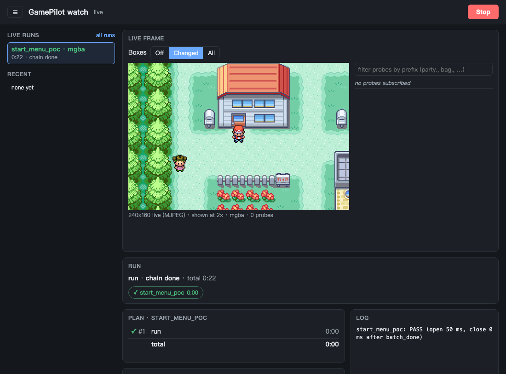

# Getting started

From a fresh clone to a first program on mGBA, and where to go from there. GamePilot has two
parts: a small C++ daemon that owns the emulator or the console, and the `gamepilot` command,
written in OCaml, that runs programs through it.

## What you need

- macOS, Linux or Windows. The mGBA runner script and the Switch tools are tested on macOS.
- [opam](https://opam.ocaml.org/doc/Install.html) with OCaml 5.2 or later.
- CMake, Ninja and OpenCV for the daemon (`brew install cmake ninja opencv`, or
  `apt-get install cmake ninja-build libopencv-dev`).
- Your own FireRed ROM for mGBA. No ROM is included in or needed by this repository.

## Get the code

```sh
git clone --recurse-submodules https://github.com/dayfine/GamePilot
cd GamePilot
```

In a clone made without `--recurse-submodules`, run `git submodule update --init` once.

## Build

The OCaml side, from `src/` (the first build installs the dependencies with opam):

```sh
cd src
opam install . --deps-only --yes
opam exec -- dune build
```

The daemon, from the repo root (`daemon/README.md` has the rest of its flags):

```sh
cmake -S daemon -B daemon/build -G Ninja -DCMAKE_BUILD_TYPE=Release
cmake --build daemon/build -j4
```

## Pick a backend

- **mGBA**: the emulator, where every FireRed program is tested first. Set it up with
  [Running on mGBA](mgba.md): mGBA, its Lua bridge and the settings file.
- **The Switch**: a capture card and a PABotBase2 controller board, as Pokémon Automation's
  Computer Control uses them. Set up the hardware with its
  [setup guide](https://pokemonautomation.github.io/SetupGuide/index.html) (steps 1 to 3); its
  app sets the board to NS1 Wired Pro Controller, the mode GamePilot needs and never changes.
  Then follow [Switch bring-up](switch-bring-up.md), one check at a time.

The rest of this page uses mGBA.

## A first run

The simplest program is [Start Menu PoC](guide/frlg.start_menu_poc.md): it opens and closes
FireRed's Start menu. Start mGBA with your ROM and load the bridge
([by hand](mgba.md#load-the-bridge-by-hand)), and walk the player into the overworld.

Then run it with its watch page (47801: the port the bridge printed):

```sh
cd src && opam exec -- dune exec -- gamepilot run frlg.start_menu_poc --console --watch \
    --mgba-port 47801 --daemon ../daemon/build/gamepilot_daemon
```

It starts its own daemon, prints the page's URL and the hub's (`http://127.0.0.1:47901/`), runs,
and stops the daemon at the end:

```
start_menu_poc: PASS (open 50 ms, close 0 ms after batch_done)
```

With `~/.config/gamepilot/env` set up ([mGBA](mgba.md)), `sh run/run_checkpoints_on_mgba.sh
frlg.start_menu_poc` does the same and starts and closes mGBA too.

`--console` runs on whatever the game shows. Without it the program first loads
`$GAMEPILOT_STATES/overworld.ss`, a save state you make in mGBA (File > Save State File).

## What you see

Open the page URL the run printed, or find it on the hub. The watch page shows the live frame, the
probe boxes a program reads, its plan and log, the daemon's health, and a Stop button:



`gamepilot runs` lists the live runs in the terminal, with each page's address:

```
CHECKPOINT MODE         TRIAL  ELAPSED  STATE                                    PAGE
start_menu_poc run          1/1    0:41     -                                        http://127.0.0.1:47902/
all runs: http://127.0.0.1:47901/
```

Checkpoint runs start their own daemons: `gamepilot run ... --watch` gives each run a page on a
free port and prints its address, with the hub's, `http://127.0.0.1:47901/`, which lists every
live run on this machine and links to each page. More in `docs/design/Watch-Page.md`.

## Watch from another device

To watch from a phone or another computer, put `export GAMEPILOT_WATCH_LISTEN=0.0.0.0` in
`~/.config/gamepilot/env` (or pass `--listen 0.0.0.0`). The runner then also prints the run's LAN
address with `?token=...`: open that one to get Stop. The hub and a page without the token are
read-only.

On macOS with the firewall on, the first run asks "Do you want the application gamepilot_daemon
to accept incoming network connections?": choose Allow (System Settings > Network > Firewall >
Options lists it afterwards). A rebuilt daemon may ask again.

## Where to go next

- `gamepilot programs` lists every program, where it runs and the command that runs it.
- [User guides](guide/README.md): a page per program, with what your save needs and what to
  do when it stops.
- [Running on mGBA](mgba.md): checkpoint runs, the runner script and its settings.
- [Switch bring-up](switch-bring-up.md): the first session on the console.
